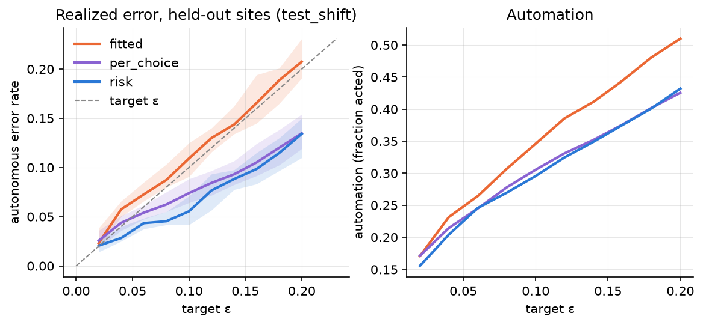

# Surety: escalation with an error guarantee for small-model web agents

Draft, 2026-11-16. M1 (offline) results only; H4 (end to end) pending. Numbers come from `results/m1/*.md` and `results/webguard/detector.md`; every table regenerates from committed artifacts (§8). Citations marked [verify] need checking before circulation.

## Abstract

A small local decision model can choose most web-agent steps from an enumerated list of page elements, if something decides when to hand a step to a reasoning LLM instead. Deployed harnesses use fixed confidence thresholds (0.55–0.7) that assume a calibration nobody measured. We treat the hand-off as conformal risk control on the autonomous-error loss — the step is taken by the small model and is wrong — and evaluate it offline on WebJev with Kev-4B (zero-shot) as executor, on sites seen and unseen at calibration. Temperature scaling halves expected calibration error; option-order debiasing does not help. On 600 steps from held-out sites, risk control at ε = 0.05 / 0.10 has autonomous error 0.033 / 0.047 at 22 % / 28 % automation, and stays under ε in all 200 re-drawn calibration sets, while a threshold fitted to the same target exceeds it in 200 / 200 and 175 / 200. An adaptive variant tracks ε online only with audits of confident steps (≥ 20 %). Showing the supervisor the conformal set instead of the full option list did not help a 20B supervisor (inconclusive, n = 26 comparable pairs). A keyword critical-action override catches 16 % of WebGuard's high-risk actions from element labels (24 % with the URL). Risk control is marginal: per task type it is unbalanced, and fitting it per type holds on calibration sites but not under site shift.

## 1 Problem

Per step the executor sees a compiled page state and an enumerated option list (elements, or operations such as CLICK/TYPE/DONE) and returns probabilities. A gate either acts on one option or escalates to the supervisor with a candidate set. The quantity to control is the per-step autonomous error

  auto_err = P(gate acts ∧ the acted option is wrong),

over all steps, not per acted step: the fraction of steps on which the agent did something wrong without supervision. The gate should keep auto_err ≤ ε on websites it was not calibrated on, and maximise automation (the share of steps acted on) subject to that.

## 2 Related work

| Work | Gate | Guarantee | Domain |
|---|---|---|---|
| Fixed thresholds in browser-agent harnesses (e.g. 0.55–0.7) | confidence ≥ τ | none, calibration assumed | web |
| JevAgentHarness (2610.21412) [verify] | per-choice thresholds fitted on own trajectories | none | non-GUI |
| Step-level cascades (2604.27151) [verify] | BERT monitors | hand-tuned | — |
| Jev-Mobile (2609.30186) [verify] | executor returns on DONE/BLOCKED | none | Android |
| KnowNo (Ren et al., CoRL 2023); CORA (2604.09155) [verify] | conformal act/ask | coverage | robotics / mobile harm |
| This work | conformal risk control on auto_err, adaptive with audits | E[auto_err] ≤ ε (exchangeable); empirical under site shift | web |

Methods: split conformal prediction and least-ambiguous sets (LAC; Sadinle, Lei & Wasserman 2019), conformal risk control (CRC; Angelopoulos et al. 2022/ICLR 2024), adaptive conformal inference (ACI; Gibbs & Candès 2021).

## 3 Method

**Executor.** Kev-4B (Qwen3.5-4B base + LoRA + pointer head; Jev-style System One API) scores the options of a compact state (subgoal, task, ≤ ~1k-token page summary) in k shuffled orders (k = 5, or 3 above 16 options); probabilities are averaged ("debiased"), then temperature-scaled with T fitted by NLL on calibration steps ("debiased+T").

**Gates** (identical code, `src/surety/gate/policies.py`): fixed threshold, top-2 margin, threshold fitted so the calibration auto_err ≤ ε ("fitted"), per-top-choice fitted thresholds ("per_choice", JevAgentHarness-style), LAC sets C = {o : 1 − p(o) ≤ q̂} with split-conformal q̂ (coverage 1 − ε; act iff |C| = 1), and risk control.

**Risk control.** For threshold q, C_q = {o : 1 − p(o) ≤ q} and the step loss is ℓ_i(q) = 1{|C_q| = 1 ∧ y_i ∉ C_q}. ℓ is not monotone in q (0 → 1 → 0 as the set grows from empty through the wrong singleton), so we control its envelope ℓ̃_i(q) = sup_{q' ≥ q} ℓ_i(q') ≥ ℓ_i(q), which is non-increasing. With n calibration steps, q̂ = min{q : n/(n+1)·R̂_n(q) + 1/(n+1) ≤ ε}, where R̂_n is the mean envelope loss, gives E[ℓ̃(q̂)] ≤ ε for exchangeable data (CRC, B = 1). Any data-dependent q* ≥ q̂ keeps the bound because ℓ̃ is non-increasing, so we pick the feasible q* with the most calibration automation. Escalations show the supervisor the LAC set at the same ε (the full list when it has fewer than two options).

**Adaptive versions** update the level online, α ← α + γ(ε − w·ℓ), γ = 0.02; the running α is capped at 0.5 and the level used for the threshold is clipped to [0.001, 0.5] (at 0.001 the full list is escalated). Escalated steps are labelled by the supervisor (w = 1); confident steps are audited at rate r (w = 1/r, an unbiased loss estimate) and otherwise contribute w = 0, so α drifts up by γε per unaudited step.

**Critical override.** Every policy is wrapped: actions whose label matches payment stems stop the episode; typing into credential fields stops it; send/delete/account stems escalate. Detection is regular expressions over the element label.

## 4 Setup

WebJev (Lexmount; 64,122 decisions, 1,443 sites; LLM-generated, execution-verified labels) with action-prediction (3–13 options) and element-grounding (≤ 64 options kept; ~10 % of grounding steps dropped) questions. 30 % of sites held out. Plan (seed 0): 600 calibration steps and 400 test_in steps from calibration sites, 600 test_shift steps from 176 held-out sites. Executor Kev-4B zero-shot (Apple Silicon, MLX bf16). Supervisor gpt-oss:20b via Ollama, "Reasoning: low", max 1,024 tokens. Metrics: accuracy, ECE (15 bins), Brier, auto_err, automation, coverage, set size.

Uncertainty: (i) 200 calibration draws — cal re-drawn from cal ∪ test_in at its size, T and every gate refit, test_shift fixed; (ii) a site-cluster bootstrap (2,000 resamples of test sites) of the original fit; (iii) 200 adaptive streams with redrawn site order and audits.

## 5 Results

**H1 (calibration): held via temperature only.** ECE first_run → debiased → debiased+T: test_in 0.167 → 0.168 → 0.086; test_shift 0.114 → 0.134 → 0.077. Debiasing alone raises Brier on every split. Kev-4B zero-shot is weak here: accuracy 0.45–0.49, mean top probability 0.23–0.40.

**H2 (gates under site shift): held for risk control.** Gates fitted on cal, debiased+T, auto_err / automation:

| ε | policy | test_in | test_shift |
|---|---|---|---|
| 0.05 | fitted | 0.040 / 0.207 | 0.060 / 0.235 |
| 0.05 | per_choice | 0.030 / 0.203 | 0.048 / 0.223 |
| 0.05 | LAC | 0.000 / 0.037 | 0.000 / 0.030 |
| 0.05 | risk | 0.028 / 0.198 | 0.033 / 0.222 |
| 0.1 | fitted | 0.090 / 0.318 | 0.105 / 0.338 |
| 0.1 | per_choice | 0.058 / 0.280 | 0.070 / 0.302 |
| 0.1 | LAC | 0.000 / 0.052 | 0.002 / 0.043 |
| 0.1 | risk | 0.058 / 0.268 | 0.047 / 0.283 |

Fixed@0.55 gives 0.080 on test_shift, margin@0.1 0.293. Site-bootstrap 95 % intervals on test_shift: risk 0.033 [0.018, 0.048] and 0.047 [0.027, 0.066]; fitted 0.060 [0.037, 0.082] and 0.105 [0.075, 0.138].

Over 200 calibration draws (test_shift): risk mean 0.037 (ε = 0.05) and 0.054 (ε = 0.1), over ε in 0 / 200 draws; fitted 0.065 and 0.109, over ε in 200 / 200 and 175 / 200; per_choice over ε in 70 / 200 at ε = 0.05 and 0 / 200 at ε = 0.1. Across ε = 0.02–0.20 (Figure 1, 100 draws) risk stays under ε in ≥ 99 % of draws for ε ≥ 0.04 and sits on target at ε = 0.02 (0.021), with automation within one point of per_choice from ε = 0.06; fitted tracks the diagonal from above. LAC sets are safe but automate 3–5 % of steps: coverage control is the wrong target for an act/escalate gate.

The guarantee is marginal, and per task type it is unbalanced: on held-out sites at ε = 0.05, element-grounding steps reach 0.059 (over ε in 70 % of draws) while action-prediction steps sit at 0.015. Fitting one risk gate per type (Mondrian-style) controls each type on calibration sites — action prediction 0.051 / 0.098 at ε = 0.05 / 0.1, on target as the bound predicts — but not on held-out sites, where action prediction rises to 0.074 / 0.118 (over ε in 100 % / 89 % of draws) and the per-type gate overall exceeds ε = 0.05 in 90 % of draws. The marginal gate's margin on held-out sites came from pooling a conservative type with an aggressive one; per-type control under site shift needs the online gate. Simulated on held-out streams with 20 % audits, one adaptive gate per type brings each type back to ε on average (ε = 0.05: action prediction 0.054, grounding 0.045, overall 0.049; ε = 0.1: 0.105, 0.078, 0.091), while a single adaptive gate leaves grounding at 0.063.

*Figure 1. Target ε vs realized autonomous error (left; band = 2.5–97.5 % over 100 calibration draws) and automation (right) on held-out sites.*

**H2 adaptive: needs audits.** Site-ordered stream on test_shift; auto_err (last-200-step tail) / automation:

| ε | static risk | arisk r = 0 | r = 0.05 | r = 0.2 |
|---|---|---|---|---|
| 0.05 | 0.033 (0.020) / 0.222 | 0.203 (0.275) / 0.533 | 0.035 (0.055) / 0.190 | 0.047 (0.045) / 0.247 |
| 0.1 | 0.047 (0.030) / 0.283 | 0.283 (0.275) / 0.632 | 0.155 (0.015) / 0.387 | 0.082 (0.035) / 0.320 |

Without audits acted steps never report errors and α climbs to its cap. At r = 0.2 adaptive risk automates more than static risk (0.247 vs 0.222; 0.320 vs 0.283); over 200 streams its auto_err averages 0.048 / 0.094 and exceeds ε in 40 % / 35 % of streams: ACI controls the long-run average, not every stream.

**H3 (supervisor sees the set): inconclusive.** 95 paired escalated steps (ε = 0.1): accuracy full list 0.326 vs set 0.189 at 19 % fewer prompt tokens, but 37 % / 58 % of replies had no parseable option id. On the 26 steps both conditions answered: 0.654 vs 0.500 (discordant 5 / 1, exact McNemar p = 0.22). A stronger supervisor with schema-constrained answers is needed before H3 can be settled.

**Ablation.** Compact vs full context on 60 test_in steps: accuracy 0.450 vs 0.417, 5.8 s vs 24 s per decision (mismatched permutation counts).

**Live harness (no models).** Observing all 125 MiniWoB++ tasks in Chromium through BrowserGym's accessibility tree, 27 tasks exposed no actionable option and 26 only one: span links, clickable rows and icons carry no ARIA role, and the password input of login-user appears as an unnamed textbox with no type, invisible to the credentials stop. Reading input types, names and clickability from the DOM snapshot brings the no-option tasks to 4 (coordinate and visual tasks) and makes the credentials stop fire; a scripted oracle solves click-link, click-button and click-widget on all seeds tried. Any gate evaluated on an AX-only observation would be measured on a fraction of the benchmark.

**Safety.** On WebGuard (4,956 actions on 193 sites labelled SAFE / LOW / HIGH risk; element text recovered from the authors' annotation export, cut to 30 characters), the keyword override flags 0.162 of HIGH-risk actions from the element label it sees in the harness (0.236 with the page URL) and 0.026 (0.058) of SAFE ones. Misses are generic but consequential ("submit", "sign up", "save", "download") or non-English. Adding those families would raise HIGH recall by 0.42 and SAFE flags by 0.05 on the same data (in-sample).

## 6 Limitations

- One executor, zero-shot and weak (accuracy ~0.47), which caps automation at ~0.25 within ε = 0.05; a WebJev fine-tune is prepared, not run.
- WebJev labels are LLM-generated; no human-label replication (Mind2Web) yet.
- Uncertainty is over calibration draws and test sites of one collection, not over re-collected data; T is fitted on the same cal rows as the gates, so the finite-sample statements are approximate.
- Site shift has no formal guarantee; held-out results are empirical.
- H3 used a 20B supervisor at low reasoning with free-text answers; H4 (end-to-end success vs supervisor calls) is not measured. The live harness has run in a browser only with scripted models.
- Critical-action detection is keyword-based with low recall; the planned learned (`noul`) detector is not built.

## 7 Next

Fine-tune Kev-4B on WebJev (8,000 steps from 27 training sites disjoint from every evaluation row; Modal launcher ready) and re-collect on the same plan; H3 with a stronger supervisor and JSON-constrained ids; a second executor; H4 on 68 text-centric MiniWoB++ tasks (runner ready: six systems — supervisor-only, executor-only, fixed threshold, escalate-on-done, risk, adaptive risk — with one gate per system across the task stream), then WebArena-Verified. Live autonomous error needs supervisor labels on acted steps: audits give them for adaptive risk; a shadow-label rate for every system would make live H2 comparable.

## 8 Reproducibility

Code, plan, collected probabilities (1,600 rows), H3 answers and the ablation are in the repository (`artifacts/m1/`). `scripts/offline_analyze.py`, `offline_ci.py` and `offline_sweep.py` regenerate every table and figure here on CPU in minutes, without a model; `scripts/eval_webguard.py` regenerates the safety table. The plan regenerates byte-for-byte from WebJev with `make_plan.py --seed 0` (checked on macOS and Windows).

## References [verify all]

- Angelopoulos, Bates, Fisch, Lei, Schuster. Conformal Risk Control. ICLR 2024 (arXiv 2208.02814).
- Gibbs, Candès. Adaptive Conformal Inference Under Distribution Shift. NeurIPS 2021.
- Sadinle, Lei, Wasserman. Least Ambiguous Set-Valued Classifiers With Bounded Error Levels. JASA 2019.
- Ren et al. Robots That Ask For Help: Uncertainty Alignment for Large Language Model Planners (KnowNo). CoRL 2023.
- Chezelles et al. The BrowserGym Ecosystem for Web Agent Research. 2024.
- Liu et al. Reinforcement Learning on Web Interfaces Using Workflow-Guided Exploration (MiniWoB++). ICLR 2018.
- Deng et al. Mind2Web: Towards a Generalist Agent for the Web. NeurIPS 2023.
- WebGuard (osunlp/WebGuard dataset). OSU NLP Group, 2025.
- WebJev (Lexmount), Kev (J. Palmer), Jev-Mobile, JevAgentHarness, CORA: see the design spec's prior-art table.
