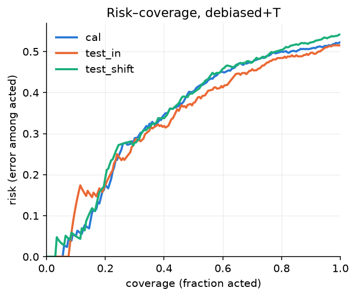

# M1 results

## Setup

- Executor: Kev-4B ([jaredpalmer/kev](https://github.com/jaredpalmer/kev)), MLX bf16, served locally, shipped temperature 2.41.
- Data: [WebJev](https://huggingface.co/datasets/Lexmount/WebJev) (Lexmount, Apache-2.0); plan 600 cal / 400 test_in / 600 test_shift rows, ≤64 options, seed 0.
- Splits: 30% of sites held out; cal and test_in from calibration sites, test_shift from held-out sites.
- State: compact (≈3.5k chars); 5 option-order permutations averaged (3 above 16 options).
- Variants: first_run = one permutation; debiased = average; debiased+T = temperature fitted on cal.
- Gates fitted on cal (debiased+T); adaptive gates replay test_shift in site blocks, γ=0.02, audit rates 0 / 0.05 / 0.2.
- H3: supervisor gpt-oss:20b via Ollama, "Reasoning: low", max_tokens 1024; n=100 escalated rows (LAC set at ε=0.1) from test_in and test_shift.
- Ablation: 60 test_in rows, full context vs compact; n_perm differs (4.233 vs 3.000).
- Not run: Clef-flash (server launch blocked this session); Mind2Web (M2). WebGuard detector recall: `results/webguard/detector.md` (2026-11-16).
- Kev fine-tune data ready (8,000 train / 500 held-out on 27 whole sites, disjoint from every evaluation row); training not yet run.

# M1 analysis: kev_compact

- collection: `runs/kev_compact.jsonl`
- rows: cal 600, test_in 400, test_shift 600
- backend: kev
- mode: compact

## H1: calibration

| split | variant | n | acc | ECE | Brier | conf_err |
|---|---|---|---|---|---|---|
| cal | first_run | 600 | 0.478 | 0.150 | 0.728 | 0.000 |
| cal | debiased | 600 | 0.477 | 0.160 | 0.743 | 0.000 |
| cal | debiased+T | 600 | 0.477 | 0.095 | 0.711 | 0.000 |
| test_in | first_run | 400 | 0.485 | 0.167 | 0.720 | 0.000 |
| test_in | debiased | 400 | 0.485 | 0.168 | 0.740 | 0.000 |
| test_in | debiased+T | 400 | 0.485 | 0.086 | 0.704 | 0.000 |
| test_shift | first_run | 600 | 0.453 | 0.114 | 0.731 | 0.000 |
| test_shift | debiased | 600 | 0.458 | 0.134 | 0.746 | 0.000 |
| test_shift | debiased+T | 600 | 0.458 | 0.077 | 0.720 | 0.002 |

## H2: gates fitted on cal (debiased+T)

| eps | policy | split | n | auto_err | auto_err_95ci | automation | coverage | set_size |
|---|---|---|---|---|---|---|---|---|
| 0.05 | fixed@0.55 | test_in | 400 | 0.060 | [0.041, 0.088] | 0.258 | 0.940 | 18.045 |
| 0.05 | fixed@0.55 | test_shift | 600 | 0.080 | [0.061, 0.104] | 0.282 | 0.920 | 17.385 |
| 0.05 | fixed@0.7 | test_in | 400 | 0.020 | [0.010, 0.039] | 0.135 | 0.980 | 19.767 |
| 0.05 | fixed@0.7 | test_shift | 600 | 0.020 | [0.011, 0.035] | 0.167 | 0.980 | 19.128 |
| 0.05 | margin@0.1 | test_in | 400 | 0.270 | [0.229, 0.316] | 0.655 | 0.730 | 9.360 |
| 0.05 | margin@0.1 | test_shift | 600 | 0.293 | [0.258, 0.331] | 0.662 | 0.707 | 10.212 |
| 0.05 | fitted@0.05 | test_in | 400 | 0.040 | [0.025, 0.064] | 0.207 | 0.960 | 18.733 |
| 0.05 | fitted@0.05 | test_shift | 600 | 0.060 | [0.044, 0.082] | 0.235 | 0.940 | 18.492 |
| 0.05 | per_choice@0.05 | test_in | 400 | 0.030 | [0.017, 0.052] | 0.203 | 0.970 | 18.745 |
| 0.05 | per_choice@0.05 | test_shift | 600 | 0.048 | [0.034, 0.069] | 0.223 | 0.952 | 18.533 |
| 0.05 | conformal@0.05 | test_in | 400 | 0.000 | [0.000, 0.010] | 0.037 | 0.932 | 8.492 |
| 0.05 | conformal@0.05 | test_shift | 600 | 0.000 | [0.000, 0.006] | 0.030 | 0.935 | 8.480 |
| 0.05 | risk@0.05 | test_in | 400 | 0.028 | [0.015, 0.049] | 0.198 | 0.670 | 2.700 |
| 0.05 | risk@0.05 | test_shift | 600 | 0.033 | [0.022, 0.051] | 0.222 | 0.650 | 2.677 |
| 0.1 | fixed@0.55 | test_in | 400 | 0.060 | [0.041, 0.088] | 0.258 | 0.940 | 18.045 |
| 0.1 | fixed@0.55 | test_shift | 600 | 0.080 | [0.061, 0.104] | 0.282 | 0.920 | 17.385 |
| 0.1 | fixed@0.7 | test_in | 400 | 0.020 | [0.010, 0.039] | 0.135 | 0.980 | 19.767 |
| 0.1 | fixed@0.7 | test_shift | 600 | 0.020 | [0.011, 0.035] | 0.167 | 0.980 | 19.128 |
| 0.1 | margin@0.1 | test_in | 400 | 0.270 | [0.229, 0.316] | 0.655 | 0.730 | 9.360 |
| 0.1 | margin@0.1 | test_shift | 600 | 0.293 | [0.258, 0.331] | 0.662 | 0.707 | 10.212 |
| 0.1 | fitted@0.1 | test_in | 400 | 0.090 | [0.066, 0.122] | 0.318 | 0.910 | 17.105 |
| 0.1 | fitted@0.1 | test_shift | 600 | 0.105 | [0.083, 0.132] | 0.338 | 0.895 | 16.458 |
| 0.1 | per_choice@0.1 | test_in | 400 | 0.058 | [0.039, 0.085] | 0.280 | 0.943 | 17.288 |
| 0.1 | per_choice@0.1 | test_shift | 600 | 0.070 | [0.052, 0.093] | 0.302 | 0.930 | 16.633 |
| 0.1 | conformal@0.1 | test_in | 400 | 0.000 | [0.000, 0.010] | 0.052 | 0.895 | 6.782 |
| 0.1 | conformal@0.1 | test_shift | 600 | 0.002 | [0.000, 0.009] | 0.043 | 0.883 | 6.578 |
| 0.1 | risk@0.1 | test_in | 400 | 0.058 | [0.039, 0.085] | 0.268 | 0.625 | 2.248 |
| 0.1 | risk@0.1 | test_shift | 600 | 0.047 | [0.032, 0.067] | 0.283 | 0.602 | 2.233 |

## H2: adaptive gates on test_shift, eps=0.05 (tail = last 200 steps)

| policy | audit_rate | n | auto_err | auto_err_95ci | tail_auto_err | automation | final_alpha |
|---|---|---|---|---|---|---|---|
| conformal@0.05 | - | 600 | 0.000 | [0.000, 0.006] | 0.000 | 0.030 | - |
| aci@0.05 | 0 | 600 | 0.000 | [0.000, 0.006] | 0.000 | 0.023 | 0.030 |
| aci@0.05 | 0.05 | 600 | 0.000 | [0.000, 0.006] | 0.000 | 0.023 | 0.030 |
| aci@0.05 | 0.2 | 600 | 0.000 | [0.000, 0.006] | 0.000 | 0.023 | 0.030 |
| risk@0.05 | - | 600 | 0.033 | [0.022, 0.051] | 0.020 | 0.222 | - |
| arisk@0.05 | 0 | 600 | 0.203 | [0.173, 0.237] | 0.275 | 0.533 | 0.500 |
| arisk@0.05 | 0.05 | 600 | 0.035 | [0.023, 0.053] | 0.055 | 0.190 | 0.250 |
| arisk@0.05 | 0.2 | 600 | 0.047 | [0.032, 0.067] | 0.045 | 0.247 | 0.050 |

## H2: adaptive gates on test_shift, eps=0.1 (tail = last 200 steps)

| policy | audit_rate | n | auto_err | auto_err_95ci | tail_auto_err | automation | final_alpha |
|---|---|---|---|---|---|---|---|
| conformal@0.1 | - | 600 | 0.002 | [0.000, 0.009] | 0.000 | 0.043 | - |
| aci@0.1 | 0 | 600 | 0.000 | [0.000, 0.006] | 0.000 | 0.040 | 0.080 |
| aci@0.1 | 0.05 | 600 | 0.000 | [0.000, 0.006] | 0.000 | 0.040 | 0.080 |
| aci@0.1 | 0.2 | 600 | 0.000 | [0.000, 0.006] | 0.000 | 0.040 | 0.080 |
| risk@0.1 | - | 600 | 0.047 | [0.032, 0.067] | 0.030 | 0.283 | - |
| arisk@0.1 | 0 | 600 | 0.283 | [0.249, 0.321] | 0.275 | 0.632 | 0.500 |
| arisk@0.1 | 0.05 | 600 | 0.155 | [0.128, 0.186] | 0.015 | 0.387 | 0.028 |
| arisk@0.1 | 0.2 | 600 | 0.082 | [0.062, 0.106] | 0.035 | 0.320 | 0.200 |

## Ablation: compact vs full (`kev_full_test_in.jsonl`, shared ids, debiased)

| mode | n | acc | ECE | Brier | latency_ms | state_chars | n_perm |
|---|---|---|---|---|---|---|---|
| compact | 60 | 0.450 | 0.177 | 0.734 | 5842 | 3646 | 4.233 |
| full | 60 | 0.417 | 0.189 | 0.744 | 23963 | 13141 | 3.000 |

## H3: supervisor on full list vs conformal set

| cond | n | acc | abstain | unparsed | fallback | acc_given_answer | acc_gold_in_set | prompt_tok | completion_tok | latency_ms |
|---|---|---|---|---|---|---|---|---|---|---|
| full | 95 | 0.326 | 0.053 | 0.368 | 0.105 | 0.564 | 0.342 | 1700 | 231 | 9543 |
| set | 95 | 0.189 | 0.063 | 0.579 | 0.116 | 0.529 | 0.228 | 1371 | 238 | 8049 |

gold_in_set (LAC coverage on the H3 sample): 0.832; paired n=95; action_prediction n=45, element_grounding n=50
both answered n=26: acc full 0.654 / set 0.500; discordant full-only 5 / set-only 1; exact McNemar p=0.219

## Uncertainty (`results/m1/kev_compact_ci.md`)

Calibration draws: cal re-drawn 200 times from cal ∪ test_in at its size (600), T and gates refit, test_in = the other 400, test_shift fixed. P(auto_err>eps) = share of draws over target.

| eps | policy | split | auto_err | auto_err_2.5–97.5% | P(auto_err>eps) | automation | automation_2.5–97.5% |
|---|---|---|---|---|---|---|---|
| 0.05 | fitted@0.05 | test_in | 0.051 | [0.027, 0.080] | 0.465 | 0.227 | [0.187, 0.263] |
| 0.05 | fitted@0.05 | test_shift | 0.065 | [0.057, 0.072] | 1.000 | 0.245 | [0.230, 0.270] |
| 0.05 | per_choice@0.05 | test_in | 0.037 | [0.020, 0.065] | 0.120 | 0.210 | [0.172, 0.250] |
| 0.05 | per_choice@0.05 | test_shift | 0.049 | [0.042, 0.057] | 0.350 | 0.228 | [0.208, 0.253] |
| 0.05 | conformal@0.05 | test_in | 0.000 | [0.000, 0.000] | 0.000 | 0.029 | [0.017, 0.040] |
| 0.05 | conformal@0.05 | test_shift | 0.000 | [0.000, 0.000] | 0.000 | 0.027 | [0.023, 0.030] |
| 0.05 | risk@0.05 | test_in | 0.034 | [0.015, 0.053] | 0.040 | 0.224 | [0.177, 0.263] |
| 0.05 | risk@0.05 | test_shift | 0.037 | [0.027, 0.045] | 0.000 | 0.226 | [0.203, 0.252] |
| 0.1 | fitted@0.1 | test_in | 0.099 | [0.062, 0.133] | 0.470 | 0.326 | [0.270, 0.383] |
| 0.1 | fitted@0.1 | test_shift | 0.109 | [0.090, 0.125] | 0.875 | 0.347 | [0.313, 0.378] |
| 0.1 | per_choice@0.1 | test_in | 0.067 | [0.040, 0.100] | 0.020 | 0.288 | [0.240, 0.345] |
| 0.1 | per_choice@0.1 | test_shift | 0.074 | [0.065, 0.088] | 0.000 | 0.305 | [0.283, 0.332] |
| 0.1 | conformal@0.1 | test_in | 0.000 | [0.000, 0.000] | 0.000 | 0.047 | [0.033, 0.063] |
| 0.1 | conformal@0.1 | test_shift | 0.001 | [0.000, 0.002] | 0.000 | 0.043 | [0.037, 0.052] |
| 0.1 | risk@0.1 | test_in | 0.067 | [0.043, 0.090] | 0.000 | 0.301 | [0.258, 0.338] |
| 0.1 | risk@0.1 | test_shift | 0.054 | [0.040, 0.070] | 0.000 | 0.294 | [0.268, 0.315] |

Site-cluster bootstrap of the original fit (2,000 resamples of test sites): risk@0.05 test_shift auto_err 0.033 [0.018, 0.048], fitted@0.05 0.060 [0.037, 0.082]; risk@0.1 0.047 [0.027, 0.066], fitted@0.1 0.105 [0.075, 0.138] — wider than the row-level Wilson intervals above. Adaptive risk at r=0.2 over 200 streams (site order and audits redrawn): auto_err 0.048 [0.023, 0.080] at eps 0.05 and 0.094 [0.060, 0.133] at eps 0.1, over target in 40% / 35% of streams.

## Learned error score (2026-11-24, `results/m1/kev_compact_learned.md`)

`LearnedRisk` replaces p_top as the ranking score with a cross-fitted logistic estimate of P(top option wrong) from five features of the debiased+T vector (p_top, margin, normalised entropy, log option count, top is DONE / BLOCKED / none_of_these); `learned` thresholds it by CRC (E[auto_err] ≤ ε), `learned_pac` by Learn-then-Test at δ = 0.1 (P(auto_err > ε) ≤ 0.1), `alearned` adaptively (γ 0.005, target 0.8·ε, doubly-robust audit feedback). Same calibration draws, streams and audit rule as above.

Calibration draws (200; T, model and gates refit per draw), mean auto_err (P(auto_err > ε)) / automation:

| ε | policy | test_in | test_shift |
|---|---|---|---|
| 0.05 | risk | 0.034 (0.040) / 0.224 | 0.037 (0.000) / 0.226 |
| 0.05 | learned_pac | 0.037 (0.125) / 0.273 | 0.038 (0.005) / 0.274 |
| 0.05 | learned | 0.049 (0.410) / 0.304 | 0.046 (0.130) / 0.302 |
| 0.1 | risk | 0.067 (0.000) / 0.301 | 0.054 (0.000) / 0.294 |
| 0.1 | learned_pac | 0.083 (0.140) / 0.388 | 0.078 (0.020) / 0.379 |
| 0.1 | learned | 0.098 (0.435) / 0.419 | 0.095 (0.260) / 0.411 |

Per task type on test_shift at ε = 0.05, learned_pac: action prediction 0.038 / 0.160, element grounding 0.039 / 0.387 (risk: 0.015 / 0.083 and 0.059 / 0.370, grounding over ε in 70 % of draws). Error ranking (AUROC for "top option wrong", original split): p_top 0.688 / 0.697 (test_in / test_shift), margin 0.734 / 0.752, learned 0.833 / 0.838.

Adaptive, 200 test_shift streams at audit rate 0.2 (auto_err, share of streams over ε, automation): at ε = 0.05 arisk 0.048 / 40 % / 0.236 and alearned 0.036 / 9 % / 0.267; at ε = 0.1, 0.094 / 35 % / 0.348 and 0.075 / 4 % / 0.372. The ablation rows in the results file separate the pieces: arisk with alearned's step size and target exceeds ε even less often (0.5 % / 0 % of streams) but automates less (0.214 / 0.301), and the learned score with ACI's defaults is as unstable as arisk (45 % / 46 % of streams over ε).

P(auto_err > ε) here is the share of draws (or streams) whose realized rate on the test rows exceeds ε. CRC bounds the mean, so `learned` sits on ε; Learn-then-Test bounds the probability that the true risk exceeds ε, and finite-test noise alone puts the realized share above δ = 0.1 on the 400 test_in rows. A clean protocol (T and the model fitted on the 400 in-site rows, the threshold on the 600 cal rows, 60 draws) gives the same test_shift numbers: learned_pac 0.039 / 0.274 and 0.081 / 0.382.

## Option-prior correction (2026-11-25, `results/m1/kev_compact_prior.md`)

`PriorCorrector` adds one log-prior offset per recurring action id, fitted by L2-penalised maximum likelihood on cal (page-element ids keep 0); T is then refitted on the corrected cal rows ("prior+T"). Offsets on the original cal split: BLOCKED −2.85, WAIT −0.84, GO_BACK −0.51, DONE −0.11, SCROLL_DOWN +0.69, TYPE_TEXT +1.23, CLICK +2.67.

Top-1 accuracy, original split: test_in 0.485 → 0.643, test_shift 0.458 → 0.588 (action prediction 0.335 → 0.650 and 0.310 → 0.570; grounding unchanged). Calibration draws (200; offsets, T, model and gates refit per draw), mean auto_err (P(auto_err > ε)) / automation:

| ε | policy | test_in | test_shift |
|---|---|---|---|
| 0.05 | learned_pac | 0.037 (0.125) / 0.273 | 0.038 (0.005) / 0.274 |
| 0.05 | learned_pac +prior | 0.040 (0.185) / 0.306 | 0.052 (0.485) / 0.308 |
| 0.05 | risk +prior | 0.051 (0.505) / 0.325 | 0.058 (0.785) / 0.321 |
| 0.1 | learned_pac | 0.083 (0.140) / 0.388 | 0.078 (0.020) / 0.379 |
| 0.1 | learned_pac +prior | 0.088 (0.220) / 0.453 | 0.116 (0.915) / 0.482 |
| 0.1 | risk +prior | 0.088 (0.255) / 0.432 | 0.099 (0.445) / 0.445 |

On calibration sites the correction buys automation within ε. On held-out sites the gates overshoot, entirely through action prediction (learned_pac +prior: 0.087 at ε = 0.05 and 0.196 at ε = 0.1 on those steps, while grounding falls to 0.018 / 0.036): the gate acts on twice as many action-prediction steps, and on held-out sites their errors rank worse (AUROC of p_top for action-prediction errors 0.728 → 0.666). Two fixes tried on 40 draws did not close the gap: fitting the correction out-of-site for the cal rows the error model learns from (0.050 vs 0.053 at ε = 0.05), and giving the error model the raw probabilities plus a "correction changed the pick" flag (0.097 vs 0.105 at ε = 0.1). Adaptive gates hold ε on held-out streams but return most of the gain: alearned on prior+T 0.042 (over ε in 20 % of streams) / 0.266 at ε = 0.05 and 0.082 (10.5 %) / 0.406 at ε = 0.1, against 0.036 (9 %) / 0.267 and 0.075 (4 %) / 0.372 without the correction. Not adopted: the executor's scores carry a large, fixable label bias, but calibration data from more sites (or a fine-tuned executor) is needed before that accuracy turns into automation that holds on new sites.

## Reading the tables

- C: the gate's set for a step. Threshold gates (fixed, margin, fitted, per_choice): C = {top option} when acting, else all options. conformal / aci (LAC) and risk / arisk: C = {o : 1 − p(o) ≤ q̂}. |C|=1 acts; anything else escalates.
- auto_err = #(|C|=1 ∧ wrong) / N, over all N steps (not per acted step). auto_err_95ci = Wilson interval treating steps as independent; it ignores site clustering and, for the adaptive rows, the dependence along the stream. Site-cluster bootstrap intervals and the spread over calibration draws are in `results/m1/kev_compact_ci.md`.
- automation = #(|C|=1) / N.
- coverage = #(gold ∈ C) / N. set_size = mean |C|. For risk rows both describe the risk-threshold set; escalations show the supervisor the LAC set (the full list when it has fewer than 2 options).
- tail_auto_err = auto_err over the last 200 steps of the stream. final_alpha = α at stream end, clipped to [0.001, 0.5].
- Audit weight rule: per step, w = 1 if |C| ≠ 1 (escalated, label seen); if |C| = 1, w = 1/r with probability r (audited), else w = 0. Update α ← α + γ(ε − w·ℓ), ℓ = miscoverage (aci) or 1{|C|=1 ∧ wrong} (arisk). At r=0 acted steps never report errors, so α rises by γε per step to the 0.5 cap.
- H1: acc and ECE (15 bins) on the top option; Brier over all options; conf_err = share with p_max ≥ 0.9 and wrong.
- H3: acc over all rows (abstain and unparsed count as wrong); abstain = supervisor answered NONE; unparsed = no option id parsed; fallback = id parsed from the reasoning text; acc_given_answer = acc over rows with an id; acc_gold_in_set = acc over rows whose LAC set holds gold; tokens and latency are means over all rows.
- Ablation: debiased probabilities (no T) on shared ids.
- T (temperature) and every gate are fitted on the same `cal` rows; the `cal` rows of `debiased+T` are in-sample. Test rows never enter any fit. Because T is fitted on cal, the conformal and risk-control finite-sample guarantees hold only approximately; the calibration-draw table in `results/m1/kev_compact_ci.md` measures the effect empirically (risk@ε exceeds ε on test_shift in 0 of 200 draws).
