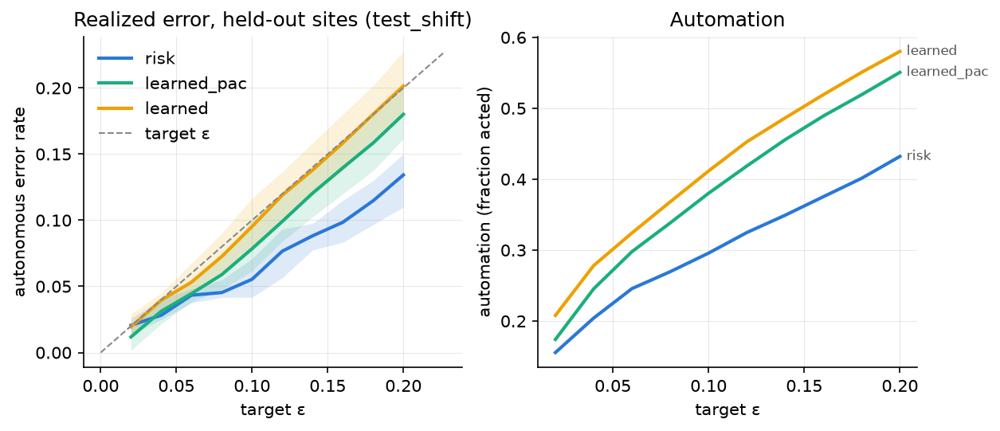

# Learned error score: kev_compact

- collection: `artifacts/m1/kev_compact.jsonl`; debiased+T probabilities (T fitted on cal)
- learned = `LearnedRisk`: L2 logistic model of P(top option wrong) from p_top, margin, normalised entropy, log option count and top-is-terminal, cross-fitted on cal (5 folds); act iff the mean fold prediction ≤ τ
- learned@eps: τ by conformal risk control on the out-of-fold scores (E[auto_err] ≤ eps); learned_pac@eps: τ by Learn-then-Test, binomial fixed-sequence tests at δ = 0.1 (P(auto_err > eps) ≤ 0.1); risk@eps: RiskConformal, as in the M1 tables
- the guarantees are approximate twice over: T is fitted on the same cal rows, and out-of-fold scores come from models fitted on 4/5 of them; test_shift (held-out sites) has no guarantee at all
- adaptive gates: one stream per seed (test_shift sites in random order), escalations labelled (w = 1), acted steps audited at rate 0.2 (w = 1/r); alearned's step size and margin were chosen on these same streams (in-sample)

## Error ranking on the original split (AUROC of each score for 'top option wrong')

| split | task_type | n | error_rate | AUROC p_top | AUROC margin | AUROC entropy | AUROC learned |
|---|---|---|---|---|---|---|---|
| test_in | all | 400 | 0.515 | 0.688 | 0.734 | 0.722 | 0.833 |
| test_in | action_prediction | 200 | 0.665 | 0.671 | 0.665 | 0.686 | 0.812 |
| test_in | element_grounding | 200 | 0.365 | 0.789 | 0.820 | 0.720 | 0.807 |
| test_shift | all | 600 | 0.542 | 0.697 | 0.752 | 0.735 | 0.838 |
| test_shift | action_prediction | 300 | 0.690 | 0.728 | 0.722 | 0.732 | 0.817 |
| test_shift | element_grounding | 300 | 0.393 | 0.789 | 0.827 | 0.718 | 0.827 |

## Calibration draws (200: cal re-drawn from cal ∪ test_in, T, model and gates refit)

| eps | split | policy | draws | auto_err | auto_err_2.5–97.5% | P(auto_err>eps) | automation | automation_2.5–97.5% |
|---|---|---|---|---|---|---|---|---|
| 0.05 | test_in | risk@0.05 | 200 | 0.034 | [0.015, 0.053] | 0.040 | 0.224 | [0.177, 0.263] |
| 0.05 | test_in | learned@0.05 | 200 | 0.049 | [0.022, 0.083] | 0.410 | 0.304 | [0.257, 0.363] |
| 0.05 | test_in | learned_pac@0.05 | 200 | 0.037 | [0.018, 0.065] | 0.125 | 0.273 | [0.230, 0.325] |
| 0.05 | test_shift | risk@0.05 | 200 | 0.037 | [0.027, 0.045] | 0.000 | 0.226 | [0.203, 0.252] |
| 0.05 | test_shift | learned@0.05 | 200 | 0.046 | [0.038, 0.055] | 0.130 | 0.302 | [0.278, 0.328] |
| 0.05 | test_shift | learned_pac@0.05 | 200 | 0.038 | [0.030, 0.045] | 0.005 | 0.274 | [0.242, 0.303] |
| 0.1 | test_in | risk@0.1 | 200 | 0.067 | [0.043, 0.090] | 0.000 | 0.301 | [0.258, 0.338] |
| 0.1 | test_in | learned@0.1 | 200 | 0.098 | [0.065, 0.140] | 0.435 | 0.419 | [0.367, 0.485] |
| 0.1 | test_in | learned_pac@0.1 | 200 | 0.083 | [0.052, 0.125] | 0.140 | 0.388 | [0.335, 0.450] |
| 0.1 | test_shift | risk@0.1 | 200 | 0.054 | [0.040, 0.070] | 0.000 | 0.294 | [0.268, 0.315] |
| 0.1 | test_shift | learned@0.1 | 200 | 0.095 | [0.075, 0.120] | 0.260 | 0.411 | [0.375, 0.455] |
| 0.1 | test_shift | learned_pac@0.1 | 200 | 0.078 | [0.058, 0.098] | 0.020 | 0.379 | [0.343, 0.422] |

## The same draws by task type (marginal guarantees: no per-type control is claimed)

| eps | split | task_type | policy | draws | auto_err | auto_err_2.5–97.5% | P(auto_err>eps) | automation | automation_2.5–97.5% |
|---|---|---|---|---|---|---|---|---|---|
| 0.05 | test_in | action_prediction | risk@0.05 | 200 | 0.008 | [0.000, 0.021] | 0.000 | 0.081 | [0.048, 0.111] |
| 0.05 | test_in | action_prediction | learned@0.05 | 200 | 0.046 | [0.018, 0.079] | 0.385 | 0.192 | [0.146, 0.247] |
| 0.05 | test_in | action_prediction | learned_pac@0.05 | 200 | 0.034 | [0.010, 0.063] | 0.115 | 0.164 | [0.116, 0.222] |
| 0.05 | test_in | element_grounding | risk@0.05 | 200 | 0.059 | [0.027, 0.091] | 0.685 | 0.366 | [0.282, 0.432] |
| 0.05 | test_in | element_grounding | learned@0.05 | 200 | 0.052 | [0.020, 0.094] | 0.465 | 0.416 | [0.350, 0.486] |
| 0.05 | test_in | element_grounding | learned_pac@0.05 | 200 | 0.040 | [0.015, 0.075] | 0.230 | 0.382 | [0.330, 0.442] |
| 0.05 | test_shift | action_prediction | risk@0.05 | 200 | 0.015 | [0.010, 0.020] | 0.000 | 0.083 | [0.070, 0.100] |
| 0.05 | test_shift | action_prediction | learned@0.05 | 200 | 0.045 | [0.037, 0.057] | 0.130 | 0.179 | [0.157, 0.203] |
| 0.05 | test_shift | action_prediction | learned_pac@0.05 | 200 | 0.038 | [0.030, 0.047] | 0.005 | 0.160 | [0.137, 0.187] |
| 0.05 | test_shift | element_grounding | risk@0.05 | 200 | 0.059 | [0.040, 0.070] | 0.700 | 0.370 | [0.330, 0.403] |
| 0.05 | test_shift | element_grounding | learned@0.05 | 200 | 0.047 | [0.037, 0.053] | 0.110 | 0.424 | [0.393, 0.457] |
| 0.05 | test_shift | element_grounding | learned_pac@0.05 | 200 | 0.039 | [0.030, 0.047] | 0.000 | 0.387 | [0.343, 0.427] |
| 0.1 | test_in | action_prediction | risk@0.1 | 200 | 0.019 | [0.000, 0.039] | 0.000 | 0.109 | [0.073, 0.146] |
| 0.1 | test_in | action_prediction | learned@0.1 | 200 | 0.078 | [0.041, 0.134] | 0.155 | 0.267 | [0.216, 0.338] |
| 0.1 | test_in | action_prediction | learned_pac@0.1 | 200 | 0.069 | [0.035, 0.117] | 0.060 | 0.247 | [0.197, 0.309] |
| 0.1 | test_in | element_grounding | risk@0.1 | 200 | 0.115 | [0.072, 0.152] | 0.740 | 0.492 | [0.429, 0.543] |
| 0.1 | test_in | element_grounding | learned@0.1 | 200 | 0.118 | [0.067, 0.170] | 0.745 | 0.571 | [0.490, 0.655] |
| 0.1 | test_in | element_grounding | learned_pac@0.1 | 200 | 0.098 | [0.056, 0.157] | 0.430 | 0.529 | [0.462, 0.609] |
| 0.1 | test_shift | action_prediction | risk@0.1 | 200 | 0.032 | [0.020, 0.053] | 0.000 | 0.121 | [0.100, 0.150] |
| 0.1 | test_shift | action_prediction | learned@0.1 | 200 | 0.092 | [0.073, 0.113] | 0.170 | 0.257 | [0.223, 0.297] |
| 0.1 | test_shift | action_prediction | learned_pac@0.1 | 200 | 0.080 | [0.057, 0.097] | 0.010 | 0.236 | [0.200, 0.270] |
| 0.1 | test_shift | element_grounding | risk@0.1 | 200 | 0.076 | [0.060, 0.090] | 0.000 | 0.467 | [0.437, 0.490] |
| 0.1 | test_shift | element_grounding | learned@0.1 | 200 | 0.098 | [0.070, 0.137] | 0.380 | 0.565 | [0.510, 0.627] |
| 0.1 | test_shift | element_grounding | learned_pac@0.1 | 200 | 0.077 | [0.060, 0.107] | 0.045 | 0.522 | [0.480, 0.577] |

## Adaptive gates on test_shift streams, eps=0.05 (200 site orders and audit draws)

| policy | audit_rate | streams | auto_err | auto_err_2.5–97.5% | P(auto_err>eps) | tail_auto_err | automation | automation_2.5–97.5% |
|---|---|---|---|---|---|---|---|---|
| arisk (γ 0.02) | 0.2 | 200 | 0.048 | [0.023, 0.080] | 0.400 | 0.050 | 0.236 | [0.133, 0.340] |
| arisk (γ 0.005, target 0.8·eps) | 0.2 | 200 | 0.034 | [0.020, 0.048] | 0.005 | 0.037 | 0.214 | [0.148, 0.265] |
| alearned (γ 0.02, κ 0, ipw) | 0.2 | 200 | 0.050 | [0.023, 0.085] | 0.450 | 0.048 | 0.267 | [0.158, 0.372] |
| alearned (γ 0.005, κ 0, dr) | 0.2 | 200 | 0.047 | [0.027, 0.072] | 0.350 | 0.049 | 0.304 | [0.233, 0.365] |
| alearned (γ 0.005, κ 0.2, dr): default | 0.2 | 200 | 0.036 | [0.022, 0.060] | 0.090 | 0.037 | 0.267 | [0.198, 0.338] |

## Adaptive gates on test_shift streams, eps=0.1 (200 site orders and audit draws)

| policy | audit_rate | streams | auto_err | auto_err_2.5–97.5% | P(auto_err>eps) | tail_auto_err | automation | automation_2.5–97.5% |
|---|---|---|---|---|---|---|---|---|
| arisk (γ 0.02) | 0.2 | 200 | 0.094 | [0.060, 0.133] | 0.350 | 0.098 | 0.348 | [0.267, 0.432] |
| arisk (γ 0.005, target 0.8·eps) | 0.2 | 200 | 0.063 | [0.043, 0.092] | 0.000 | 0.071 | 0.301 | [0.253, 0.355] |
| alearned (γ 0.02, κ 0, ipw) | 0.2 | 200 | 0.099 | [0.060, 0.152] | 0.460 | 0.103 | 0.391 | [0.287, 0.502] |
| alearned (γ 0.005, κ 0, dr) | 0.2 | 200 | 0.096 | [0.068, 0.128] | 0.355 | 0.098 | 0.411 | [0.360, 0.465] |
| alearned (γ 0.005, κ 0.2, dr): default | 0.2 | 200 | 0.075 | [0.050, 0.102] | 0.040 | 0.077 | 0.372 | [0.307, 0.422] |

## Target ε vs realized error and automation on test_shift (100 calibration draws)

| eps | policy | auto_err | auto_err_2.5–97.5% | P(auto_err>eps) | automation |
|---|---|---|---|---|---|
| 0.02 | learned | 0.019 | [0.014, 0.029] | 0.350 | 0.208 |
| 0.02 | learned_pac | 0.012 | [0.002, 0.020] | 0.030 | 0.174 |
| 0.02 | risk | 0.021 | [0.014, 0.026] | 0.480 | 0.156 |
| 0.04 | learned | 0.040 | [0.033, 0.045] | 0.390 | 0.278 |
| 0.04 | learned_pac | 0.031 | [0.022, 0.039] | 0.000 | 0.245 |
| 0.04 | risk | 0.028 | [0.025, 0.040] | 0.010 | 0.204 |
| 0.06 | learned | 0.053 | [0.043, 0.068] | 0.130 | 0.324 |
| 0.06 | learned_pac | 0.045 | [0.038, 0.053] | 0.000 | 0.298 |
| 0.06 | risk | 0.043 | [0.037, 0.048] | 0.000 | 0.246 |
| 0.08 | learned | 0.073 | [0.059, 0.090] | 0.170 | 0.368 |
| 0.08 | learned_pac | 0.059 | [0.047, 0.073] | 0.000 | 0.338 |
| 0.08 | risk | 0.045 | [0.042, 0.055] | 0.000 | 0.270 |
| 0.1 | learned | 0.095 | [0.079, 0.117] | 0.270 | 0.412 |
| 0.1 | learned_pac | 0.078 | [0.062, 0.099] | 0.030 | 0.380 |
| 0.1 | risk | 0.055 | [0.042, 0.071] | 0.000 | 0.296 |
| 0.12 | learned | 0.119 | [0.102, 0.137] | 0.390 | 0.453 |
| 0.12 | learned_pac | 0.099 | [0.084, 0.122] | 0.030 | 0.419 |
| 0.12 | risk | 0.077 | [0.057, 0.093] | 0.000 | 0.325 |
| 0.14 | learned | 0.138 | [0.119, 0.158] | 0.320 | 0.486 |
| 0.14 | learned_pac | 0.120 | [0.102, 0.140] | 0.020 | 0.456 |
| 0.14 | risk | 0.088 | [0.077, 0.098] | 0.000 | 0.349 |
| 0.16 | learned | 0.158 | [0.137, 0.180] | 0.450 | 0.519 |
| 0.16 | learned_pac | 0.140 | [0.120, 0.160] | 0.020 | 0.489 |
| 0.16 | risk | 0.098 | [0.083, 0.115] | 0.000 | 0.375 |
| 0.18 | learned | 0.180 | [0.162, 0.202] | 0.460 | 0.551 |
| 0.18 | learned_pac | 0.158 | [0.137, 0.180] | 0.030 | 0.519 |
| 0.18 | risk | 0.115 | [0.097, 0.130] | 0.000 | 0.401 |
| 0.2 | learned | 0.201 | [0.181, 0.228] | 0.500 | 0.580 |
| 0.2 | learned_pac | 0.180 | [0.162, 0.202] | 0.030 | 0.551 |
| 0.2 | risk | 0.134 | [0.110, 0.150] | 0.000 | 0.432 |

